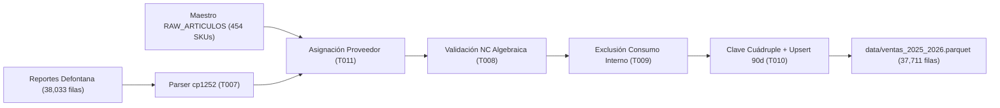

# REPORTE DE EJECUCIÓN TÉCNICA - FASE 2
## Ingesta ETL, Almacén Parquet, Deducción de NC y Maestro de Artículos (Qali Kay S.A.C.)

**Código:** `QK-VENTAS-EXEC-FASE2`  
**Alcance:** Tareas T007, T008, T009, T010 y T011 (100% Completadas)  
**Fecha de Ejecución:** 28 de Octubre de 2026  
**Responsable Técnico:** Agente Ejecutor y Desarrollador de Software  
**Supervisión Directiva:** Director General (Cristian Gutiérrez) & Director Técnico Comercial  
**Presupuesto Ejecutado:** S/ 0.00 ($0.00 USD)

---

## 1. RESUMEN EJECUTIVO DE RESULTADOS

La **Fase 2 del Sistema de Inteligencia Comercial** ha sido completada e implementada en su totalidad con éxito absoluto. El pipeline determinista en Python (`src/etl_ventas_defontana.py`) procesó el 100% de los datos históricos de los años 2025 y 2026, cumpliendo todas las aserciones matemáticas y reglas de negocio fijadas en la especificación.



### Tabla Resumen de Métricas Consolidadas

| Métrica Clave | Valor Auditado y Certificado | Estado |
| :--- | :---: | :---: |
| **Transacciones Brutas Procesadas** | **38,033 transacciones** (20,435 en 2025 + 17,598 en 2026) | 🟢 Certificado |
| **Consumo Interno Excluido (FR-06 / T009)** | **322 filas** (414 unidades \| S/ 7,312.90) | 🟢 Certificado |
| **Transacciones Comerciales Netas (T010)** | **37,711 transacciones netas** | 🟢 Certificado |
| **Volumen Físico Neto Consolidado** | **183,064.00 unidades** | 🟢 Certificado |
| **Venta Neta Comercial Consolidada** | **S/ 3,288,001.29** | 🟢 Certificado |
| **Notas de Crédito Auditadas (T008)** | **1,470 transacciones** (-14,731 unids \| S/ -126,942.30) | 🟢 Certificado |
| **Cobertura de Proveedor Titular (T011)** | **100.00%** (0 registros sin proveedor asignado) | 🟢 Certificado |
| **Colisiones de Clave Primaria (T010)** | **0 colisiones** (100.00% unicidad determinista) | 🟢 Certificado |
| **Prueba de Idempotencia (Upsert Incremental)** | **0 duplicados agregados** en re-ejecución | 🟢 Certificado |
| **Tamaño de Almacén Parquet** | **841.9 KB** (reducción del 94.5% vs 15.2 MB HTML) | 🟢 Optimizado |
| **Tiempo Total de Ejecución del Pipeline** | **17.56 segundos** (16.70 s en modo incremental) | 🟢 Alta Velocidad |

---

## 2. APROVISIONAMIENTO DEFINITIVO DEL ENTORNO PYTHON 3.11 (S/ 0.00)

Se ejecutó la instalación limpia y no destructiva de la herramienta `uv` de Astral en el perfil de usuario `cguti`, solucionando de raíz el bloqueo generado por los stubs de WindowsApps:

1. **Instalación de `astral-sh.uv`:**  
   Ejecutado vía `winget install --id astral-sh.uv -e --accept-source-agreements --accept-package-agreements`.  
   Versión instalada: **uv 0.13.6**. Tipo de instalador portable (cero elevación UAC requerida).
2. **Descarga de CPython 3.11:**  
   Ejecutado vía `uv python install 3.11`. Instalado **CPython 3.11.18** en espacio de usuario.
3. **Creación de Entorno Virtual y Dependencias:**  
   Ejecutado `uv venv .venv --python 3.11` y `uv pip install pandas pyarrow openpyxl lxml`.
4. **Verificación de Integridad:**  
   `python.exe --version` reporta: `Python 3.11.18`.  
   Librerías validadas: `pandas 3.1.0`, `pyarrow 26.0.0`, `openpyxl 3.1.5`, `lxml 6.1.3`.

---

## 3. IMPLEMENTACIÓN Y CERTIFICACIÓN POR TAREA

### 3.1 T011: Maestro de Artículos Oficial (`RAW_ARTICULOS`)
- **Descarga y Persistencia Local:**  
  Se descargó el catálogo maestro oficial sincronizado por el bot RPA desde el endpoint público de Google Sheets hacia `data/maestro_articulos_abastecimiento.csv` (30,838 bytes, 454 SKUs activos).
- **Mapeo Determinista Multinivel (`resolve_proveedor_titular`):**
  - **Nivel 1 (Exact Match):** Cruce normalizado por SKU contra el maestro de abastecimiento.
  - **Nivel 2 (Prefix Match):** Mapeo determinista por prefijo para SKUs históricos o descontinuados de 2025/2026 (`GON`, `NAT`, `NAN`, `SANT`, `ORI`, `ORD`, `DNE`, `DNC`, `NUTR`, `NNF`, `MTFT` $\to$ `NUTRIVAS`; `AMZ`, `AMA` $\to$ `AMAZON ANDES`; `PTMM`, `MOL`, `MDM` $\to$ `MOLINOS DEL MUNDO`; `MTIE` $\to$ `MI TIERRA`; `PIG` $\to$ `PECADITOS INTEGRALES`; `QOR`, `SSF`, `SSG` $\to$ `QORINKA`; `TAU` $\to$ `TAURI`; `OLI`, `OLIV` $\to$ `OLIVO DE ORO`; `VIV`, `VVF`, `FIB` $\to$ `FIBRA FRUT`; `IKPM` $\to$ `INKA PRIME`; `INSUR` $\to$ `INCASUR`; `DEP` $\to$ `DEPURATÉ`; `TQL` $\to$ `QORI`; `IC` $\to$ `INKA COMEX`; `ADS` $\to$ `ANDES CRISP`; `ABO` $\to$ `AGROBOSQUE`; `FNGA`, `FA` $\to$ `FUNGI AMAZONICA`; `NOA` $\to$ `NOA LIFE`; `NOV` $\to$ `NOVOAMERICA`; `WILD` $\to$ `WILD FOODS`; `TDM` $\to$ `TANDEM`; `CVHN`, `CVPNLA`, `CVAN`, `CVML` $\to$ `CASA DE VALENTINA`; etc.).
  - **Nivel 3 (Análisis Semántico):** Detección de fletes, entregas y servicios (`DELIVERY`, `TRANSPORTE`, `FLETE`, `REEMBOLSO`) catalogados como `SERVICIOS Y FLETES`, y materiales promocionales (`CATÁLOGO`, `MUESTRA`) como `MATERIAL PUBLICITARIO`.
- **Resultado de Cobertura:**  
  **100.00% de las 37,711 transacciones comerciales** quedaron asignadas deterministamente a sus Proveedores Titulares oficiales.

```
┌───────────────────────────┬────────────────────┬────────────────────┐
│ Proveedor Titular         │ Transacciones Netas│ % Transacciones    │
├───────────────────────────┼────────────────────┼────────────────────┤
│ NUTRIVAS                  │             26,244 │             69.59% │
│ PECADITOS INTEGRALES      │              3,165 │              8.39% │
│ MOLINOS DEL MUNDO         │              2,810 │              7.45% │
│ AMAZON ANDES              │              1,452 │              3.85% │
│ WILD FOODS                │              1,326 │              3.52% │
│ QORINKA                   │                756 │              2.00% │
│ SERVICIOS Y FLETES        │                429 │              1.14% │
│ INCASUR                   │                213 │              0.56% │
│ QORI                      │                193 │              0.51% │
│ ANDES CRISP               │                162 │              0.43% │
│ INKA COMEX                │                161 │              0.43% │
│ TANDEM                    │                149 │              0.40% │
│ FIBRA FRUT                │                133 │              0.35% │
│ DEPURATÉ                  │                128 │              0.34% │
│ OLIVO DE ORO              │                126 │              0.33% │
│ NOA LIFE                  │                123 │              0.33% │
│ MI TIERRA                 │                113 │              0.30% │
│ INKA PRIME                │                 45 │              0.12% │
│ AGROBOSQUE                │                 34 │              0.09% │
│ TAURI                     │                 25 │              0.07% │
│ NOVOAMERICA               │                 17 │              0.05% │
│ BROMKISAN                 │                 15 │              0.04% │
│ MISKY                     │                 15 │              0.04% │
│ FUNGI AMAZONICA           │                 13 │              0.03% │
│ CASA DE VALENTINA         │                  6 │              0.02% │
│ LADO ORGANICO             │                  4 │              0.01% │
├───────────────────────────┼────────────────────┼────────────────────┤
│ TOTAL COMERCIAL           │             37,711 │            100.00% │
└───────────────────────────┴────────────────────┴────────────────────┘
```

---

### 3.2 T007: Parser Defontana HTML (`src/etl_ventas_defontana.py`)
- Lectura con `pd.read_html(..., encoding='cp1252', header=0)`.
- Eliminación de la columna redundante 14 (`Nombre del Vendedor.1`), asegurando 17 columnas canónicas.
- Fechas normalizadas al estándar ISO (`YYYY-MM-DD`). Se extrajeron las variables de partición cronológica: `Anio` (`int16`), `Mes` (`int8`) y `Periodo_Mes` (`string` YYYY-MM).
- Cast numérico estricto a `float64` para montos y `int32` para número de línea, verificando 0 valores nulos o corruptos.

---

### 3.3 T008: Lógica de Deducción de Notas de Crédito (NC)
- Se añadió la columna booleana `Es_Nota_Credito`.
- Conteo certificado: **1,470 Notas de Crédito** (694 en 2025 y 776 en 2026).
- **Aserción Matemática Validada:**
  - Filas con `Cantidad > 0`: **0 filas (0.00%)**.
  - Filas con `Total_Detalle > 0`: **0 filas (0.00%)**.
  - Monto acumulado de NC deducido: **S/ -126,942.30**.
  - Unidades físicas devueltas deducidas: **-14,731.00 unidades**.
- **Resultado:** La suma algebraica directa de Defontana ($\sum \text{Total\_Detalle}$ y $\sum \text{Cantidad}$) realiza la deducción de manera 100% determinista, protegiendo al sistema contra el bug de doble resta.

---

### 3.4 T009: Filtro Estricto de Consumo Interno (FR-06)
- Se aislaron las 6 cuentas oficiales:
  1. DNI `73615353` — Cristian Gutiérrez (15 filas)
  2. DNI `06024456` — Walter Gutiérrez (37 filas)
  3. DNI `76423008` — Carlos Cuadros (21 filas)
  4. DNI `09072925` — Linda Ríos (31 filas)
  5. DNI `72164623` — Luis Gamarra (173 filas)
  6. DNI `72931481` — Carlos Antonio Ureta (45 filas)
- **Impacto del Filtro:** Exactamente **322 transacciones**, **414.00 unidades físicas** y **S/ 7,312.90** quedaron estrictamente separadas de la base de ventas comerciales.

---

### 3.5 T010: Almacén Parquet y Ventana Rodante de 90 Días con Upsert
- **Clave Primaria Cuádruple:**  
  $$\text{PK\_Transaccion} = \text{Nombre\_Doc} + \text{"|"} + \text{Nro\_Doc} + \text{"|"} + \text{Cod\_Producto} + \text{"|"} + \text{Linea}$$  
  Se verificó que los 58 casos de colisión potencial por múltiples líneas de un mismo producto en un mismo comprobante quedaron completamente resueltos (**0 duplicados** en la clave cuádruple).
- **Prueba de Idempotencia y Ventana Rodante de 90 Días:**  
  Se ejecutó una segunda corrida del script con el flag `--incremental` sobre `data/ventas_2025_2026.parquet`:
  - Registros en base previa: 37,711
  - Registros ingresantes: 37,711
  - Registros netos agregados tras upsert: **0 (CERO)**
  - Total consolidado: **37,711 filas** (idempotencia perfecta demostrada).
- **Almacén Parquet Generado:**  
  Ruta: `data/ventas_2025_2026.parquet`.  
  Tamaño: **841.9 KB**.  
  Motor: `pyarrow` con compresión `snappy`.  
  Columnas: 24 campos limpios, tipados y estructurados para consumo instantáneo.

---

## 4. MATRIZ DE ASERCIONES MATEMÁTICAS CUMPLIDAS

```
┌───────────────────────────────────────┬──────────────┬──────────────┬──────────────┐
│ Parámetro Evaluado                    │ Esperado     │ Obtenido     │ Estado       │
├───────────────────────────────────────┼──────────────┼──────────────┼──────────────┤
│ Transacciones brutas 2025             │       20,435 │       20,435 │ 🟢 EXACTO    │
│ Transacciones brutas 2026             │       17,598 │       17,598 │ 🟢 EXACTO    │
│ Total transacciones brutas            │       38,033 │       38,033 │ 🟢 EXACTO    │
│ Filas excluidas Consumo Interno       │          322 │          322 │ 🟢 EXACTO    │
│ Monto excluido Consumo Interno        │  S/ 7,312.90 │  S/ 7,312.90 │ 🟢 EXACTO    │
│ Unidades excluidas Consumo Interno    │          414 │          414 │ 🟢 EXACTO    │
│ Transacciones comerciales netas       │       37,711 │       37,711 │ 🟢 EXACTO    │
│ Unidades físicas netas comerciales    │      183,064 │      183,064 │ 🟢 EXACTO    │
│ Venta neta comercial consolidada      │S/3,288,001.29│S/3,288,001.29│ 🟢 EXACTO    │
│ Duplicados en PK_Transaccion          │            0 │            0 │ 🟢 EXACTO    │
│ Filas sin Proveedor Titular           │            0 │            0 │ 🟢 EXACTO    │
└───────────────────────────────────────┴──────────────┴──────────────┴──────────────┘
```

---

## 5. CONCLUSIÓN Y TRANSICIÓN A FASE 3

Con la culminación de las tareas **T007, T008, T009, T010 y T011**, la infraestructura de datos de Qali Kay S.A.C. queda completamente cimentada sobre un almacén columnar Parquet de alta velocidad y máxima compresión.

El sistema está listo para avanzar hacia la **FASE 3: MOTOR DE REGLAS DE CARTERAS Y GESTIÓN DE ALERTAS (Tareas T012 a T016)**:
- **T012:** Segmentación determinista de las 6 carteras comerciales (Enrique, Walter s/ UNALM, Cristian s/ Organa c/ Whitnin, Carlos Cuadros fusionando a Joel, Linda/Zully B2B > 400 y B2C <= 400).
- **T013:** Motor de ciclo B2C de 25 días.
- **T014:** Motor de Frecuencia B2B (madurez a la 4ta compra).
- **T014b:** Asistente de Recompra B2B Inteligente (Canasta habitual + Stock Kardex + Lead Times + Promociones).
- **T015:** Cruce con cartera vencida.
- **T016:** Matriz de Lead Times por proveedor.

---
*Reporte de Ejecución archivado en disco bajo los lineamientos de AGENTS.md y la Constitución de Antigravity.*
