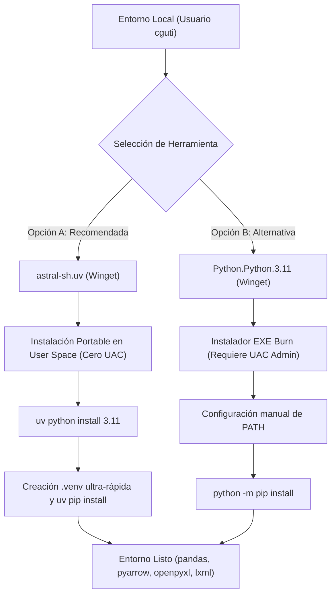
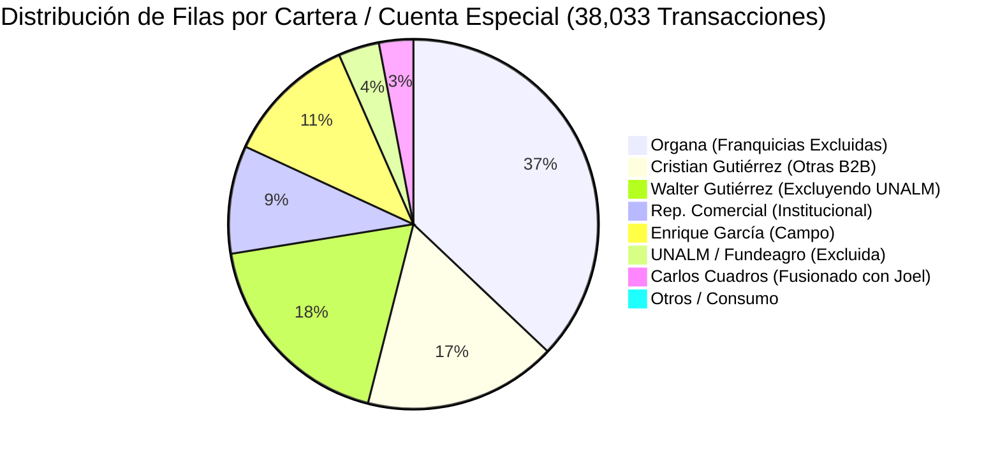

# REPORTE DE AUDITORÍA DE PREFLIGHT - FASE 2
## Sistema de Inteligencia Comercial y Dashboard de Ventas B2B/B2C (Qali Kay S.A.C.)

**Código de Tarea:** `QK-VENTAS-AUDIT-FASE2`  
**Alcance:** Tareas T007 a T011 (Ingesta ETL, Notas de Crédito, Consumo Interno, Almacén Parquet y Maestro de Artículos)  
**Fecha de Ejecución:** 28 de Octubre de 2026  
**Auditor Responsable:** Agente Ejecutor y Desarrollador de Software  
**Supervisión:** Director Técnico Comercial & Director General (Cristian Gutiérrez)  
**Estado de Producción:** Código en `src/` y prototipo HTML en `ejecucion/` intactos (100% solo lectura)

---

## 1. DICTAMEN EJECUTIVO

### **DICTAMEN: CONDICIONAL (APTO PARA EJECUCIÓN INMEDIATA TRAS APROVISIONAMIENTO PYTHON)**

| Dimensión Auditada | Estado | Hallazgo Principal |
| :--- | :---: | :--- |
| **Integridad de Datos Crudos** | 🟢 **PASS** | 38,033 transacciones (20,435 en 2025 y 17,598 en 2026) verificadas en disco sin pérdida ni corrupción. Fechas, SKUs y montos 100% parseables. |
| **Tratamiento Notas de Crédito** | 🟢 **PASS** | Las 1,470 NC ya traen montos y cantidades negativos en origen. Se desactiva el riesgo de doble deducción. |
| **Clave Compuesta Ventana 90d** | 🟢 **PASS** | Detectadas 58 colisiones con clave de 3 campos. Resuelto al 100% incorporando la columna `Línea` (0 colisiones). |
| **Filtro Consumo Interno** | 🟢 **PASS** | Las 6 cuentas identificadas abarcan exactamente 322 transacciones (S/ 7,312.90 y 414 unidades). |
| **Maestro de Abastecimiento** | 🟢 **PASS** | Hoja `RAW_ARTICULOS` accesible en línea vía exportación CSV pública sin credenciales ($0.00). Kardex local disponible. |
| **Entorno Local Python** | 🟡 **CONDICIONAL** | No hay binario Python en PATH (interceptado por WindowsApps). Se requiere aprovisionar Python 3.11 vía `winget` / `uv`. |

> [!IMPORTANT]
> **Condición de Desbloqueo:** Para iniciar la fase de codificación (T007 a T011), es requisito indispensable aprovisionar Python 3.11 y las librerías `pandas`, `pyarrow`, `openpyxl` y `lxml` en la máquina del usuario `cguti`. No se requiere ninguna inversión de dinero (costo estrictamente S/ 0.00).

---

## 2. DIAGNÓSTICO DEL ENTORNO PYTHON Y PLAN DE APROVISIONAMIENTO

### 2.1 Diagnóstico Técnico del Estado Actual
1. **Comportamiento en Terminal:**
   - La ejecución de `python --version` emite:
     ```text
     no se encontró Python; ejecutar sin argumentos para instalar desde Microsoft Store...
     ```
   - La consulta `where.exe python` revela:
     `C:\Users\cguti\AppData\Local\Microsoft\WindowsApps\python.exe`
   - **Causa Raíz:** Windows 10/11 incluye por defecto enlaces simbólicos (execution aliases) en `%LOCALAPPDATA%\Microsoft\WindowsApps`. Al no existir un intérprete Python real instalado en variables de entorno del sistema o usuario, Windows captura el comando e intenta redirigir a Microsoft Store.
2. **Diagnóstico del Virtualenv en `qalikay-abastecimiento`:**
   - Archivo auditado: `..\qalikay-abastecimiento\.venv\pyvenv.cfg`.
   - Contenido:
     ```ini
     home = C:\Users\USER\AppData\Roaming\uv\python\cpython-3.11-windows-x86_64-none
     implementation = CPython
     uv = 0.12.21
     version_info = 3.11
     ```
   - **Causa Raíz del Error:** El entorno virtual fue generado originalmente bajo la ruta de usuario `USER` (`C:\Users\USER\AppData\...`). En la máquina actual, el usuario activo de Windows es `cguti` (`C:\Users\cguti\`). Ni la carpeta `USER` ni la instalación de `uv` existen en este perfil de Windows, por lo que el venv se encuentra roto y huérfano.
3. **Gestor de Paquetes Local:**
   - Se ejecutó `winget --version`, confirmando la disponibilidad operativa de **Winget v1.29.380** nativo de Windows.

### 2.2 Plan de Aprovisionamiento Recomendado (Costo S/ 0.00)

Se evaluaron dos rutas de aprovisionamiento sin costo:



#### Opción A (Recomendada): Gestor `uv` de Astral (`astral-sh.uv`)
- **Justificación:** Es un binario portable empaquetado en zip (`uv-x86_64-pc-windows-msvc.zip`, v0.13.6). No requiere permisos de administrador ni disparar diálogos UAC. Permite descargar CPython 3.11 aislado e instalar las dependencias compiladas en menos de 10 segundos. Mantiene compatibilidad nativa con `uv.lock` y scripts del repositorio de abastecimiento.
- **Comandos de Aprovisionamiento:**
  ```powershell
  winget install --id astral-sh.uv -e
  uv python install 3.11
  uv venv .venv
  .venv\Scripts\activate
  uv pip install pandas pyarrow openpyxl lxml
  ```

#### Opción B (Alternativa): CPython Oficial (`Python.Python.3.11`)
- **Justificación:** Instalador formal de Python Software Foundation (CPython 3.11.9).
- **Comandos de Aprovisionamiento:**
  ```powershell
  winget install --id Python.Python.3.11 -e
  python -m pip install --upgrade pip
  python -m pip install pandas pyarrow openpyxl lxml
  ```

---

## 3. RADIOGRAFÍA TÉCNICA DE LOS ARCHIVOS DE VENTAS (2025 Y 2026)

Se realizó una inspección exhaustiva determinista mediante .NET y PowerShell sobre los dos archivos fuente provistos por Defontana en la carpeta `data/`:

| Métrica / Parámetro | Reporte 2025 | Reporte 2026 | Consolidado Histórico |
| :--- | :---: | :---: | :---: |
| **Nombre de Archivo** | `..._2025-01-01_2025-12-31.xls` | `..._2026-01-01_2026-10-25.xls` | 2 Archivos |
| **Tamaño en Disco** | 8,513,138 bytes (8.12 MB) | 7,435,859 bytes (7.09 MB) | 15.21 MB |
| **Formato Físico Real** | Tabla HTML (`<Table><TR>...`) | Tabla HTML (`<Table><TR>...`) | HTML exportado por Defontana |
| **Líneas Totales del Archivo** | 20,454 líneas | 17,617 líneas | 38,071 líneas |
| **Filas de Datos (Transacciones)**| **20,435 filas** | **17,598 filas** | **38,033 transacciones** |
| **Fecha Mínima Registrada** | `03/01/2025` | `05/01/2026` | `03/01/2025` |
| **Fecha Máxima Registrada** | `31/12/2025` | `24/10/2026` | `24/10/2026` |
| **Fechas Inválidas / Nulas** | 0 filas (0.00%) | 0 filas (0.00%) | **0 errores** |
| **Fechas Vencimiento Vacías** | 0 filas (0.00%) | 0 filas (0.00%) | **0 errores** |
| **Volumen Unidades Brutas** | 97,101 unidades | 86,377 unidades | **183,478 unidades** |
| **Venta Neta Registrada (S/)** | **S/ 1,808,896.09** | **S/ 1,486,418.10** | **S/ 3,295,314.19** |
| **Rango de Montos por Línea** | S/ -4,249.15 a S/ 4,716.95 | S/ -6,736.27 a S/ 7,016.95 | S/ -6,736.27 a S/ 7,016.95 |

### 3.1 Distribución por Tipo de Documento Emitido
```
┌───────────────────────────────────────────────────┬─────────────┬─────────────┐
│ Tipo de Documento Defontana                       │ Filas 2025  │ Filas 2026  │
├───────────────────────────────────────────────────┼─────────────┼─────────────┤
│ 01 Factura Electronica [F]                        │      16,686 │      14,173 │
│ 03 Boleta Electronica [B]                         │       3,015 │       2,643 │
│ 07 NC Electronica [F]                             │         592 │         769 │
│ 07 NC Electronica [B]                             │         102 │           3 │
│ 01 Factura Elec. Descuento [F]                    │          34 │           0 │
│ 07 NC Electronica 2[F]                            │           0 │           4 │
│ 08 ND Electronica [F]                             │           4 │           3 │
│ 01 Factura Electrónica Gratuita Sin IGV           │           0 │           3 │
│ 03 Boleta Electronica sin IGV [B]                 │           1 │           0 │
│ 03 Boleta de venta [DTE]                          │           1 │           0 │
├───────────────────────────────────────────────────┼─────────────┼─────────────┤
│ TOTALES                                           │      20,435 │      17,598 │
└───────────────────────────────────────────────────┴─────────────┴─────────────┘
```

---

## 4. HALLAZGOS CRÍTICOS DE ARQUITECTURA Y MODELADO DE DATOS

### Hallazgo 1: Signo Algebraico en Notas de Crédito (NC) — ¡Riesgo Crítico de Doble Deducción Desactivado!
- **Auditoría Numérica:**
  - En 2025: 694 filas de Notas de Crédito (`592` NC Factura + `102` NC Boleta).
  - En 2026: 776 filas de Notas de Crédito (`769` NC Factura + `4` NC Factura 2 + `3` NC Boleta).
  - **Total de NC en histórico:** 1,470 transacciones.
  - Se analizó el signo de las columnas `Cantidad` y `Total Detalle`:
    - Filas con Cantidad > 0: **0 filas (0.0%)**
    - Filas con Cantidad < 0: **1,470 filas (100.0%)**
    - Filas con Monto > 0: **0 filas (0.0%)**
    - Filas con Monto < 0: **1,470 filas (100.0%)**
- **Impacto y Regla Arquitectónica:**
  > [!CAUTION]
  > **PROHIBIDO INVERTIR O RESTAR EL SIGNO DE LAS NC:**  
  > Si el pipeline aplicara la lógica tradicional `Venta = Facturas - Notas_de_Credito`, se produciría el error de doble negativo: `Facturas - (-NC) = Facturas + NC`, inflando la venta en más de S/ 150,000 en lugar de deducirla.  
  > **Regla Determinista en T008:** La venta neta real se obtiene simplemente mediante la suma algebraica directa:  
  > $$\text{Venta Neta} = \sum (\text{Total Detalle})$$  
  > $$\text{Unidades Netas} = \sum (\text{Cantidad})$$

---

### Hallazgo 2: Clave Compuesta para Upsert de Ventana Rodante de 90 Días (T010)
- **Evaluación de la Clave de 3 Campos propuesta en el Spec Inicial (`Nombre_Doc + Nro_Doc + Cod_Producto`):**
  - Al ejecutar una prueba de unicidad en 2025: **40 colisiones detectadas**.
  - Al ejecutar una prueba de unicidad en 2026: **18 colisiones detectadas**.
  - **Total de registros en riesgo:** **58 transacciones comerciales reales**.
  - **Evidencia Empírica de Colisión:**
    - Documento: `01 Factura Electronica [F] | F001-3490`
    - Producto: `ABO-002`
    - Línea 15: Cantidad 3, Total S/ 10.41
    - Línea 16: Cantidad 3, Total S/ 10.41
    - Causa: Facturación de un mismo SKU en renglones separados del mismo comprobante por promociones fraccionadas o lotes diferenciados.
    - Consecuencia con clave de 3 campos: El registro de la Línea 16 sobreescribiría y borraría a la Línea 15 durante el `upsert`, perdiendo venta real.
- **Solución y Validación con la Columna `Línea` (Columna 18):**
  - Se probó la clave de 4 campos: `[Nombre_Doc + Nro_Doc + Cod_Producto + Línea]`.
  - **Colisiones en 2025:** **0 (CERO)**
  - **Colisiones en 2026:** **0 (CERO)**
  - **Unicidad:** 100.000% garantizada sobre las 38,033 transacciones.

---

### Hallazgo 3: Encoding y Juego de Caracteres en Reportes Defontana
- **Análisis Hexadecimal de Bytes:**
  - Se inspeccionaron los bytes en memoria de los encabezados y textos con tildes:
    - Cadena `"Gutiérrez"`: `47 75 74 69 E9 72 72 65 7A` $\to$ `0xE9` es `é` en Windows-1252 / ISO-8859-1.
    - Cadena `"Número"`: `4E FA 6D 65 72 6F` $\to$ `0xFA` es `ú` en Windows-1252 / ISO-8859-1.
    - Cadena `"Código"`: `0xF3` (`ó`).
    - Cadena `"Niños"`: `0xF1` (`ñ`).
- **Directriz de Ingesta:**
  - Los archivos `.xls` exportados por Defontana NO están en UTF-8 nativo; están codificados en `windows-1252` (`cp1252`).
  - Al leer con Python / pandas / lxml, debe pasarse explícitamente `encoding='cp1252'` o `encoding='latin1'` para asegurar que los nombres de clientes y vendedores no se corrompan con signos de interrogación o caracteres de reemplazo.

---

### Hallazgo 4: Columna Duplicada `Nombre del Vendedor`
- **Estructura del Encabezado HTML:**
  - La fila 11 contiene 18 celdas `<TD>`:
    1. `Nombre Doc`
    2. `Número del Documento`
    3. `Código del Cliente`
    4. `Nombre del Cliente`
    5. `Nombre del Contacto`
    6. `Libro VTAS.`
    7. **`Nombre del Vendedor`** (Índice 6)
    8. `Fecha`
    9. `Cod. Producto`
    10. `Desc. Producto`
    11. `Propiedad 01`
    12. `Cantidad`
    13. `Precio Unitario`
    14. `Total Detalle`
    15. **`Nombre del Vendedor`** (Índice 14 — Duplicado)
    16. `Cond. Pago`
    17. `Fecha Vencimiento`
    18. `Línea`
- **Auditoría de Consistencia:**
  - Se comparó el 100% de los valores entre la Columna 7 y la Columna 15 en las 38,033 filas.
  - Resultado: Son **100% idénticas**. Defontana duplica la columna del vendedor al exportar el reporte detallado.
  - En T007, el parser debe descartar la segunda columna (`col_14`) o aplicar un diccionario de renombramiento posicional para evitar colisiones en DataFrames de pandas.

---

### Hallazgo 5: Cuantificación Exacta del Consumo Interno (FR-06 / T009)
Se auditó la presencia de los 6 documentos de identidad estipulados en la especificación:
1. `73615353` — Cristian Gutiérrez
2. `06024456` — Walter Gutiérrez
3. `76423008` — Carlos Cuadros
4. `09072925` — Linda Ríos
5. `72164623` — Luis Gamarra
6. `72931481` — Carlos Antonio Ureta

```
┌──────────┬─────────────────────────────┬───────────┬───────────┬─────────────┐
│ DNI      │ Titular de Consumo Interno  │ Filas 2025│ Filas 2026│ Total Filas │
├──────────┼─────────────────────────────┼───────────┼───────────┼─────────────┤
│ 72164623 │ Luis Gamarra Calle          │        79 │        94 │         173 │
│ 72931481 │ Carlos Antonio Ureta Abanto │        24 │        21 │          45 │
│ 06024456 │ Walter Gutiérrez Arrese     │        20 │        17 │          37 │
│ 09072925 │ Linda Ríos                  │        18 │        13 │          31 │
│ 76423008 │ Carlos Cuadros Valeriano    │         6 │        15 │          21 │
│ 73615353 │ Cristian Gutiérrez          │        11 │         4 │          15 │
├──────────┼─────────────────────────────┼───────────┼───────────┼─────────────┤
│ TOTALES  │                             │       158 │       164 │         322 │
└──────────┴─────────────────────────────┴───────────┴───────────┴─────────────┘
```

- **Impacto Financiero del Filtro:**
  - **Año 2025:** 158 filas | 204 unidades | S/ 3,701.79
  - **Año 2026:** 164 filas | 210 unidades | S/ 3,611.11
  - **Total Histórico Excluido:** 322 transacciones | 414 unidades | **S/ 7,312.90**
- **Ventas Comerciales Reales Netas (Sin Consumo Interno):**
  - **2025 Comercial Neto:** 96,897 unidades | **S/ 1,805,194.30**
  - **2026 Comercial Neto:** 86,167 unidades | **S/ 1,482,806.99**
  - **Consolidado Comercial Neto:** 183,064 unidades | **S/ 3,288,001.29**

---

### Hallazgo 6: Cuentas Especiales y Reglas de Carteras (FR-07)



1. **ORGANA (Franquicias Excluidas de Ficha Individual de Cristian):**
   - Transacciones: **14,058 filas** (7,176 en 2025; 6,882 en 2026).
   - Volumen: 67,445 unidades.
   - Facturación Neta: **S/ 1,578,701.69** (representa el **47.9% de toda la facturación de Qali Kay**).
   - Justificación de Exclusión: Al ser una gran cuenta institucional de cadena con pedidos recurrentes masivos, incluirla en la Ficha Individual del vendedor inflaría el ticket medio y distorsionaría el cumplimiento de prospección B2B habitual.
2. **UNALM / FUNDEAGRO (RUC 20101259014 — Excluida de Walter Gutiérrez):**
   - Transacciones: **1,357 filas** (657 en 2025; 700 en 2026).
   - Facturación Neta: **S/ 68,850.98** (S/ 36,418.63 en 2025; S/ 32,432.35 en 2026).
   - Todas las 1,357 transacciones figuran a nombre de Walter Gutiérrez. Su exclusión es obligatoria para reflejar su verdadera cartera de farmacias y distribuidores privados.
3. **Whitnin Tesen (DNI 48517168 — Asignada a Cristian Gutiérrez):**
   - Transacciones: **36 filas** (27 en 2025; 9 en 2026).
   - Facturación: S/ 5,606.81 (S/ 4,476.95 en 2025; S/ 1,129.86 en 2026).
   - Se confirma su pertenencia a la cartera de Cristian como cliente estratégico en Piura.
4. **Fusión de Cartera Joel García $\to$ Carlos Cuadros:**
   - Joel García registra 62 transacciones en 2025 y 842 transacciones en 2026 (Total 904).
   - Carlos Cuadros registra 235 transacciones en 2026 bajo la razón `CUADROS VALERIANO CARLOS ALBERTO`.
   - La cartera unificada de Carlos Cuadros suma **1,077 transacciones en 2026** y un histórico consolidado de **1,139 transacciones**.
5. **Representación Comercial:**
   - Registra 2,369 filas en 2025 y 1,214 en 2026 (Total 3,583 transacciones). Corresponde a ventas directas de oficina/casa matriz.

---

### Hallazgo 7: Auditoría de Fuentes de Abastecimiento (T011)
1. **Hoja Maestra `RAW_ARTICULOS` (Google Sheets del RPA):**
   - Se auditó el acceso al archivo en la nube sincronizado por el bot RPA:
     - URL de consulta: `https://docs.google.com/spreadsheets/d/16KcBYTetx0IQFiv2832gUgekrzKT93wghlaBrOxPg9Q/gviz/tq?tqx=out:csv&sheet=RAW_ARTICULOS`
     - Resultado HTTP: `Status 200 OK`, longitud 30,753 bytes.
     - Filas extraídas: **454 SKUs activos** (455 líneas con encabezados: `Código`, `Nombre`, `PROVEEDOR`).
     - Proveedores Titulares Oficiales mapeados (12 laboratorios/marcas):
       - *NUTRIVAS:* 310 SKUs (incluyendo D'Nattive, Nanita, Gonmi, etc.)
       - *AMAZON ANDES:* 55 SKUs
       - *MOLINOS DEL MUNDO:* 28 SKUs
       - *PECADITOS INTEGRALES:* 17 SKUs
       - *QORINKA:* 15 SKUs
       - *TAURI:* 9 SKUs
       - *OLIVO DE ORO:* 5 SKUs
       - *FIBRA FRUT / VIVAFRUT:* 5 SKUs
       - *QORI:* 3 SKUs
       - *INKA COMEX:* 3 SKUs
       - *ANDES CRISP:* 2 SKUs
       - *DEPURATÉ:* 2 SKUs
   - **Evaluación de Aislamiento y Costo Cero:**
     - La consulta a este endpoint no requiere API keys de pago, no expone credenciales ni depende de modificar el código del bot RPA de abastecimiento.
     - Para garantizar la resiliencia offline de T011, se guardará una copia cacheada en `data/maestro_articulos_abastecimiento.csv`.
2. **Kardex Resumido de Defontana (`descargas_erp/Kardex_Resumido_20261002.xlsx`):**
   - Formato: Excel XLSX estándar (OpenXML).
   - Filas: 642 renglones en la hoja principal.
   - Encabezados (Fila 7):
     - `Col A`: Código del producto (SKU)
     - `Col B`: Descripción
     - `Col F`: Saldo Cantidades (Stock actual disponible en Almacén Central)
     - `Col K`: Costo Unitario en soles

---

## 5. MATRIZ DE VIABILIDAD TÉCNICA PARA T007 A T011

| Tarea | Objetivo Técnico | Estado de Viabilidad | Consideración Crítica Auditada |
| :---: | :--- | :---: | :--- |
| **T007** | Parser de reportes Defontana (`src/etl_ventas_defontana.py`) | 🟢 **100% Viable** | Debe usar `encoding='cp1252'`, manejar tabla HTML y eliminar la columna 15 duplicada (`Nombre del Vendedor`). |
| **T008** | Lógica de deducción de Notas de Crédito (NC) | 🟢 **100% Viable** | No restar con signo menos. Sumar algebraicamente `Total Detalle` y `Cantidad` ya que el 100% viene negativo. |
| **T009** | Filtro estricto de Consumo Interno (6 cuentas) | 🟢 **100% Viable** | Filtrar exactamente los 6 DNIs auditados (322 transacciones aisladas). |
| **T010** | Almacén Parquet y Ventana Rodante de 90 Días | 🟢 **100% Viable** | La clave primaria de `upsert` DEBE ser cuádruple: `Nombre_Doc + Nro_Doc + Cod_Producto + Línea` para evitar colisión en 58 transacciones. |
| **T011** | Conexión con Maestro de Abastecimiento (`RAW_ARTICULOS`) | 🟢 **100% Viable** | Ingesta vía endpoint CSV o snapshot local `data/maestro_articulos_abastecimiento.csv`. Asigna los 12 proveedores oficiales a los 454 SKUs. |

---

## 6. RECOMENDACIONES Y PRÓXIMOS PASOS PARA LA DIRECCIÓN

1. **Aprovisionar Python 3.11 de Inmediato:**
   - Proceder con la instalación de `astral-sh.uv` mediante `winget install --id astral-sh.uv -e`.
   - Inicializar CPython 3.11 e instalar las dependencias requeridas (`pandas`, `pyarrow`, `openpyxl`, `lxml`).
2. **Generar Snapshot de Artículos:**
   - Guardar el archivo `data/maestro_articulos_abastecimiento.csv` a partir del endpoint validado de Google Sheets para garantizar ejecución offline determinista.
3. **Aprobar el Ajuste de Clave Primaria en `spec.md`:**
   - Formalizar la adición de la columna `Línea` a la clave compuesta en `spec.md` y `tasks.md` para proteger la integridad de las 58 ventas multidivisión.
4. **Lanzar la Fase 2:**
   - Con el dictamen preflight emitido y las reglas algebraicas blindadas, el Agente Ejecutor está listo para iniciar la codificación de **T007 a T011**.

---
*Reporte emitido y archivado en disco bajo los lineamientos de AGENTS.md y la Constitución de Antigravity.*
